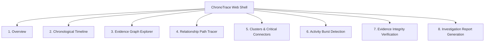

# ChronoTrace Frontend Technical Specification & Capabilities Report

## Executive Summary

The **ChronoTrace** frontend is a high-performance, single-page forensic investigation workspace built with **HTML5, Vanilla CSS, Vanilla JavaScript (ES2022), and Cytoscape.js**. Designed for zero-dependency execution, low memory overhead, and instant responsiveness, it contains **zero preloaded or mock records**—all data flows dynamically through REST endpoints served by the C backend engine.

---

## 1. Technology Stack & Design System

| Component | Implementation | Rationale |
| :--- | :--- | :--- |
| **Markup & Structure** | Semantic HTML5 | Accessible, lightweight DOM hierarchy with zero framework overhead. |
| **Styling & Theme** | Modern Vanilla CSS Custom Properties | Native CSS variables with adaptive **Dark/Light** themes, smooth gradients, and glassmorphism. |
| **Typography** | IBM Plex Sans & Bricolage Grotesque | High-legibility technical monospace and display fonts suited for forensic timelines. |
| **State Management** | Centralized Reactive State Object (`S`) | Unidirectional data flow tracking active tab, selection sets, cached events, focus entity, and connection clusters. |
| **Graph Visualization** | Cytoscape.js (v3.30.2) | Fast canvas-based force-directed (`cose`) graph rendering for entities and relationships. |
| **Network Layer** | Native `fetch` with error guards | Asynchronous API communication with centralized error toast feedback and zero-reload navigation. |

---

## 2. Global Layout & Shell Elements

### 2.1 Sidebar Navigation (`<nav>`)
- **Brand Identity**: ChronoTrace banner with deep indigo styling (`#14123a` to `#2a1b78`).
- **Tabbed Route Controller**: 8 accessible navigation tabs with real-time active indicators (`aria-selected`, lime accent borders).
- **Theme Switcher**: Instant toggle between Dark Mode and Light Mode with `localStorage` state persistence.

### 2.2 Global App Bar (`.top`)
- **Real-Time Prefix Search**: Live autocomplete input querying `/api/search?prefix=` as you type. Dispatches directly to the Evidence Graph for instant deep-linking.
- **KPI Metrics Pills**:
  - **Events Counter**: Displays total loaded evidence events.
  - **Clusters Counter**: Displays total isolated topological groups.
- **Evidence Re-Import Button (`#imp`)**: Primary trigger opening the CSV upload modal at any point during an investigation.

### 2.3 Toast Notification System (`#toast`)
- Non-blocking bottom-right alert drawer notifying users of server communication errors, empty query matches, or validation failures.

### 2.4 Evidence Import Dialog (`#dlg`)
- Native HTML5 `<dialog>` modal with backdrop blur.
- Multi-file CSV file picker validating `events.csv`, `entities.csv`, and `relationships.csv`.
- Dispatches multipart `FormData` to `/api/import` and renders real-time rejection diagnostics (row number, file, and failure reason).

---

## 3. Investigation Views & Capabilities

### View 1: Overview
- **Metric Cards (KPIs)**: Total Events, Unique Entities in Events, Connected Evidence Clusters, Level-3 (Critical) Security Incidents.
- **Quick Action Hero Banner**: Highlights temporal span of records (earliest UTC to latest UTC) and directs investigators to high-priority areas.
- **High-Severity Threat Table**: Lists all Level 3 events with clickable entity IDs that cross-link directly to the Evidence Graph.

### View 2: Chronological Timeline
- **Multi-Parameter Filter Panel**:
  - `Event type` (e.g. `login`, `privilege_escalation`, `network_transfer`).
  - `Associated entity` (e.g. `U01`, `D03`).
  - `Start UTC` & `End UTC` timestamps (`YYYY-MM-DD HH:MM:SS`).
  - `Minimum severity` selector (`Level 1`, `Level 2`, `Level 3`).
- **Ordered Event Sequence Table**:
  - Micro-second ordered timeline with secondary tie-breaking by Event ID.
  - Checkbox selection column enabling custom report building.
  - *"Trace in graph"* action button deep-linking entity node context into the Graph tab.

### View 3: Evidence Graph Explorer
- **Interactive Controls**:
  - `Start entity` selector (pre-filled when navigating from timeline or search).
  - `Depth` selector (1 to 5 hops).
  - `Traversal mode` selector: **BFS** (level-by-level exploration) or **DFS** (chain following).
- **Interactive Canvas (Cytoscape)**:
  - Color-coded nodes by entity type: `User` (violet), `Device` (amber), `File` (blue), `Event` (red).
  - Force-directed physics layout with draggable nodes and auto-rotated edge labels.
- **Bi-Directional Side Inspector (`#side`)**:
  - Click node: Displays entity metadata, type, ID, and a quick-action button to trace a shortest path.
  - Click edge: Displays relationship label and backing CSV Record ID chip.

### View 4: Relationship Path Tracer
- **Dual Endpoint Form**: `From` entity input, `To` destination input.
- **Algorithm Optimization Modes**:
  - `Fewest steps` (Breadth-First Search).
  - `Smallest time gap` (Dijkstra shortest-cost algorithm).
- **Path Breakdown**:
  - Visual ordered step-list (`A` **relationship** `B`).
  - Supporting relationship Record ID chips.
  - Path existence indicator with total cost.

### View 5: Clusters & Critical Connectors
- **Connected Topological Groups**:
  - Grid cards showing each isolated cluster, entity count, and clickable member chips.
- **Critical Connectors (Tarjan's Articulation Points)**:
  - Table identifying single-point-of-failure entities whose removal would fracture the cluster into disconnected components.

### View 6: Activity Burst Detection
- **Sliding Window Controls**:
  - Window length in minutes (e.g. 5 min).
  - Event density threshold (e.g. minimum 3 events).
- **Bursts Analysis Table**:
  - Window start and end timestamps.
  - Total events in burst and peak severity badge.
  - Chips linking all included event IDs.

### View 7: Evidence Integrity Verification
- **One-Click Cryptographic Audit (`POST /integrity/verify`)**:
  - Validates source files against baseline hashes stored upon initial import.
  - Displays comparison table: File name, Stored baseline SHA-256, Current disk SHA-256, and Match/Changed status.
  - Displays UTC verification timestamp.

### View 8: Investigation Report
- **Selective Scoping**: Works seamlessly on checked timeline events or the entire evidence corpus.
- **Dynamic Report Generator**:
  - Generates structured sections: *Executive Summary*, *Chronological Activity Sequence*, and *Entity Corroboration & Topology*.
  - Every summary item is corroborated by evidence record ID tags.
- **Download Utility**: Exports plain-text report files (`report-<id>.txt`) formatted for audit logs.

---

## 4. Client-Server API Contracts

The frontend interacts exclusively with the following REST endpoints:

| Method | Endpoint | Query / Body | Expected Response Shape |
| :--- | :--- | :--- | :--- |
| `GET` | `/api/events` | `?type=&entity=&start=&end=&min_severity=` | `{ events: [{ event_id, timestamp, entity_id, event_type, severity }] }` |
| `POST` | `/api/import` | Multipart `FormData` (`events`, `entities`, `relationships`) | `{ counts: { events, entities, relationships }, rejected: [{ file, line, reason }] }` |
| `GET` | `/api/graph` | `?entity_id=&depth=&mode=` | `{ nodes: [{ id, name, label, type }], edges: [{ record_id, source, target, relationship }] }` |
| `GET` | `/api/entities/:id` | `none` | `{ nodes: [...], edges: [...] }` |
| `GET` | `/api/path` | `?from=&to=&mode=` | `{ found: bool, cost: num, nodes: [...], edges: [{ record_id, source, target, relationship }] }` |
| `GET` | `/api/groups` | `none` | `{ groups: [{ id, size, members: ["U01", ...] }], linking: [{ id, name, reason }] }` |
| `GET` | `/api/bursts` | `?window=&threshold=` | `{ bursts: [{ start, end, count, max_severity, event_ids: [...] }] }` |
| `POST` | `/api/integrity/verify`| `{}` | `{ verified_at: str, manifest_match: bool, results: [{ file, baseline, current, match }] }` |
| `POST` | `/api/reports` | `{ title, event_ids: [] }` | `{ id: "RPT-..." }` |
| `GET` | `/api/reports/:id` | `none` | `{ title, generated_at, sections: [{ heading, items: [{ text, record_ids: [] }] }] }` |
| `GET` | `/api/search` | `?prefix=` | `{ results: [{ id, label, name, type }] }` |
| `POST` | `/api/reset` | `{}` | `{ status: "success", message: "Dataset cleared." }` |

---

## 5. Summary of Files

- [frontend/index.html](file:///c:/Users/petni/Desktop/ChronoTrace/frontend/index.html): Document structure, sidebar, topbar, modal dialog, and Cytoscape container.
- [frontend/style.css](file:///c:/Users/petni/Desktop/ChronoTrace/frontend/style.css): Full typography, tokens, animations, layout grids, cards, tables, and dark/light color schemes.
- [frontend/app.js](file:///c:/Users/petni/Desktop/ChronoTrace/frontend/app.js): Application lifecycle, reactive rendering functions (`vOverview`, `vTimeline`, `vGraph`, `vPath`, `vGroups`, `vBursts`, `vIntegrity`, `vReport`), and multipart form submission.
- [frontend/graph.js](file:///c:/Users/petni/Desktop/ChronoTrace/frontend/graph.js): Cytoscape layout definitions, node color maps, and interactive tap listeners.
